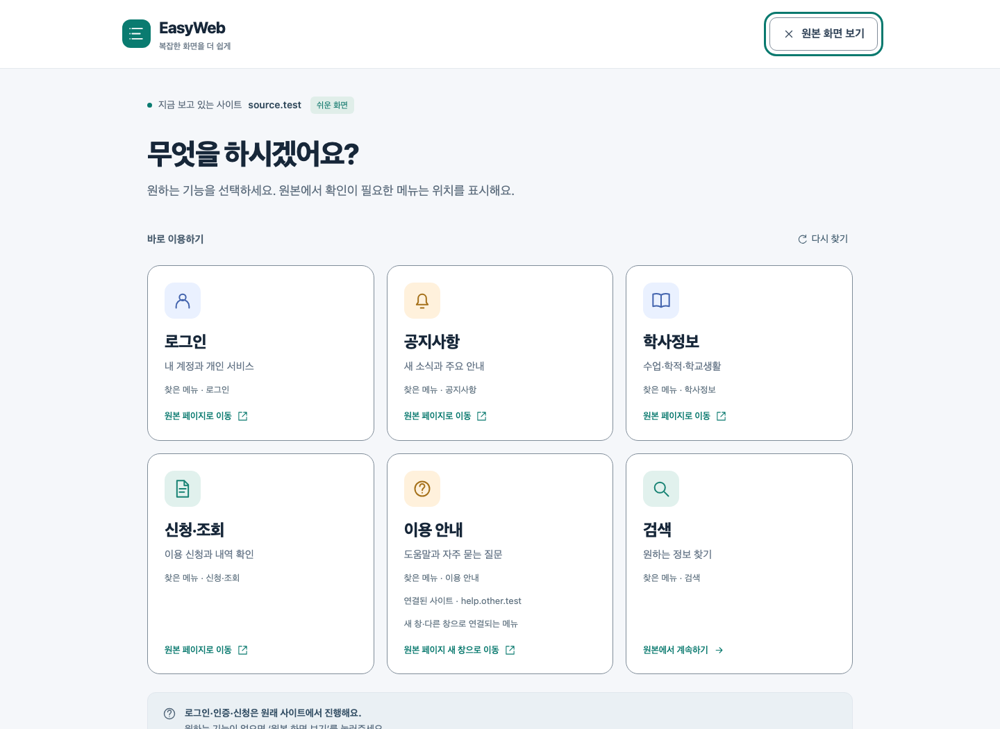

# EasyWeb

복잡한 웹페이지에서 주요 기능을 찾아 큰 버튼으로 안내하는 Chrome 확장 프로그램입니다. 현재는 개발 검증 중인 파일럿 후보입니다.

현재 버전: **0.8.0 개발 후보** · [진행표](docs/PROGRESS.md) · [현재 검증 보고서](docs/RUN_007_REPORT.md) · [작업명세서](docs/WORK_SPEC.md)

10단계의 실제 인수 조건 중 **5/10 완료**이며 공수 비율이 아닙니다. 다운로드 식별과 낡은 카드 차단을 수정해 S05를 재완료했습니다. 처음에는 최대 6개 메뉴를 보여주고 **다른 메뉴 보기 / 이전 메뉴**로 추가 후보를 살펴봅니다. 최초 6개 품질 기준은 유지합니다. 실제 VoiceOver 발화·브라우저 확대·현재 후보 설치·사용자 실증과 독립 품질 인수가 남아 있습니다. [사전 시험 절차](docs/PRETEST.md)와 [빈 결과표](evaluation/pretest/result-form.blank.md)는 준비했으며 실제 관찰은 0건입니다.

로컬 311개 검사와 기존 공개 과제 15개는 통과했습니다. 알려진 50페이지의 개발 비교는 정확227/231·재현139/140으로 개선됐지만, 새 독립 v9-v2 첫 결과는 정확26/30·재현2/15·과제 추천0/5로 실패했습니다. 추가 메뉴 재현5/15는 별도 결과입니다. 현재 고유55페이지는 개발에 노출됐으며 같은 자료를 새 독립 검증으로 세지 않습니다. 소스·실패·ZIP은 [RUN-007 보고서](docs/RUN_007_REPORT.md), 직전 안전 수정은 [RUN-006 기록](docs/RUN_006_REPORT.md)을 따릅니다.

## 지금 실행하기

빌드된 확장 프로그램은 이 프로젝트의 `dist/` 폴더에 있습니다.

1. Chrome 주소창에서 `chrome://extensions`를 엽니다.
2. 개발자 모드를 켭니다.
3. **압축해제된 확장 프로그램을 로드합니다**를 선택합니다.
4. `/Users/khyun_03/easyweb/dist` 폴더를 선택합니다. 프로젝트 루트가 아니라 `manifest.json`이 있는 `dist`를 선택하세요.
5. 일반 웹사이트에 접속하여 확장 메뉴의 **EasyWeb — 쉬운 화면**을 누릅니다.
6. 원본 화면 보기 / Esc / 확장 버튼을 다시 누르면 닫힙니다.

선택 사항: 확장을 도구 모음에 고정합니다. `Alt+Shift+E` 단축키도 사용할 수 있습니다. 충돌하면 `chrome://extensions/shortcuts`에서 설정하세요.

Chrome 내부 페이지, Chrome 웹 스토어 등 스크립트 주입 제한 페이지에서는 실행되지 않습니다. 도구 모음에 `!`가 표시되면 일반 웹사이트로 이동해 다시 실행하세요. 페이지를 이동한 후에는 확장 버튼을 다시 눌러 분석합니다.

## 로컬 예시 화면

```bash
cd /Users/khyun_03/easyweb
npm run demo
```

브라우저에서 <http://127.0.0.1:4173>을 열고 **EasyWeb 쉬운 화면 열기**를 누릅니다. 테스트용 가상 대학 페이지이며 실제 대학 사이트가 아닙니다. 이 버튼은 화면 코드를 시연하며 Chrome 확장 권한 부여를 재현하지 않습니다.



실제 VoiceOver 발화·실제 브라우저 확대·메뉴 전환·설치 복구를 직접 확인할 때는 [수동 확인 안내](docs/MANUAL_CHECK.md)의 절차와 <http://127.0.0.1:4183/manual-check.html>를 사용합니다. 이 로컬 점검 화면과 위 가상 대학 데모는 실제 설치·사용자 실증과 구별합니다.

## 개발 명령

Node.js와 npm을 사용합니다. 현재 환경에서는 Node 26으로 확인했습니다.

```bash
npm ci
npm run build
npm run typecheck
npx playwright install chromium
npm test
```

- `npm run dev`: 변경 시 재빌드. 확장 관리 화면과 대상 웹페이지를 각각 새로고침합니다.
- `npm run verify`: 타입·빌드·로컬 회귀·개발용 15페이지 품질·합성 성능을 한 번에 확인하고 JSON 요약을 만듭니다. 독립 평가·실제 사이트·네이티브 설치·사용자 실증은 별도입니다.
- `npm run test:a11y`: 상태/화면 조합의 axe·대비·키보드·재배치 검사와 스크린샷. 최신 검사 수와 결과는 [RUN-007](docs/RUN_007_REPORT.md), [수동 확인 범위](docs/ACCESSIBILITY.md)를 따릅니다.
- `npm run test:tasks`: 고정 15개 공개 과제의 실제 카드 이동/원본 제어 도달을 확인합니다. 로그인·입력·신청·다운로드를 실행하지 않습니다. 외부 사이트 상태에 영향을 받습니다.
- `npm run test:live`: 상명대 공개 홈페이지의 탐지·화면 스크린샷을 남깁니다.
- `npm run evaluate -- --split=all`: 원래 15페이지의 개발용 회귀. 노출된 보류 자료를 독립 검증으로 재사용하지 않습니다. [분리·이력](evaluation/README.md)을 따릅니다.
- `npm run benchmark`: 혼합 1,000개 제어 10회의 분석·화면 준비 p95. `-- --shape=flat` 또는 `-- --shape=table`로 펼침 버튼 1,000개와 500행·1,000개 제어 표를 각각 검사합니다. `npm run verify`는 세 형태를 모두 검사하며 워밍업 제외·합성 환경·표본 한계를 기록합니다.
- `npm run package`: 동일 소스로 빌드·ZIP 재현성을 확인하고 후보 ZIP·SHA256·보고서를 만듭니다. 현재 산출물 경로와 최종 해시는 [RUN-007](docs/RUN_007_REPORT.md)를 따릅니다. 게시하지 않습니다.
- `npm run study:analyze -- --help`: 실제 자료가 준비된 뒤 정식 실증 분석. [실증 안내](docs/USER_STUDY.md)의 명령을 사용합니다.

## 구현한 기능

- 보이는 링크·버튼·검색창의 안전한 이름과 URL, 주요 메뉴·주변 제목을 이용한 기능 분류.
- 로그인 / 검색 / 공지사항 / 학사정보 / 신청·조회 / 이용 안내 중 탐지한 분류만 표시. 검색 필터·서식 표·정보 패널·중첩 카드 제목·경계가 분명한 제목과 제어·명시적 펼침 영역·FAQ 읽기 문맥을 함께 확인합니다.
- 목적지·원본 제어 기준 중복 제거, 분류 다양성과 중요도를 먼저 확보하고 별도 후보로 최대 6개까지 채웁니다. 다른 메뉴 보기 / 이전 메뉴로 추가 후보를 탐색하며 최초 6개 평가 기준은 유지합니다.
- 일반 HTTP(S) 링크 이동. 스크립트 버튼·페이지 내 앵커 등은 원본 요소 위치 강조.
- Shadow DOM의 독립 스타일, 모달 키보드 초점, 모바일 너비 배치, 원본 초점·스크롤 복귀.
- input·textarea·contenteditable·사용자 정의 입력 역할의 입력 내용을 이름 추출에서 제외합니다. 연결된 label·이미지 대체문구·주변 제목의 중첩 입력 경로도 검사합니다. 별도 서버로 분석 결과를 보내지는 않습니다. 원본 링크로 이동하면 해당 사이트의 일반 네트워크 요청은 발생합니다.
- 원본 요소 제거·숨김·이름·href·기준 URL·경로 변경을 감지해 이전 카드를 무효화하고 다시 찾기를 제공합니다. 클릭·가운데 클릭·우클릭·드래그 시점에도 확인합니다.

## 프로젝트 구조

```text
src/                 확장 프로그램 TypeScript와 화면 스타일
extension/           Manifest V3 설정
scripts/             빌드, 로컬 예시 서버, 실제 사이트 확인
demo/                가상 대학 테스트 페이지
tests/               동작·키보드·확장 통합 테스트
evaluation/          5개 공개 사이트 정답표와 축약 메뉴 fixture
dist/                Chrome에서 로드할 빌드 결과
docs/                개발 계획, 검증 결과, 스크린샷
```

## 처음 시험할 때

[설치 안내](docs/INSTALL.md)에 따라 `dist/`를 로드한 뒤 [1인 사전 시험](docs/PRETEST.md)의 다섯 공개 과제를 해 봅니다. 일반 링크는 바로 이동하고, JavaScript·인증·다운로드 등의 제어는 원본 위치를 안내합니다. 안내 성공은 원본 기능 실행 완료를 뜻하지 않습니다. 가려짐·변경·초점 실패는 이유를 표시하며 새로 찾을 수 있습니다.

DOM 표식 없는 property/위임 이벤트는 확장에서 완전히 판별할 수 없어 일반 링크 카드가 원본 JS/SPA 처리를 우회할 수 있습니다. `FileDown` 경로와 해당 링크의 명시적 다운로드 신호 조합은 원본 위치를 안내하도록 수정했습니다. 모든 불투명 다운로드 URL·아이콘 체계의 식별을 보증하지 않으며, 해당 링크의 응답·실제 파일 실행은 관찰하지 않았습니다. [액션 정책](docs/ACTION_POLICY.md), [사이트·환경 지원표](docs/SUPPORT_MATRIX.md), [현재 검증 기록](docs/VALIDATION.md)을 확인하세요. 실제 인증·신청·결제·삭제는 이번 공개 과제 범위에 포함하지 않습니다.

## 기술 참고

- [Chrome activeTab](https://developer.chrome.com/docs/extensions/develop/concepts/activeTab)
- [Chrome 스크립트 주입](https://developer.chrome.com/docs/extensions/reference/api/scripting)
- [WCAG 2.2](https://www.w3.org/TR/WCAG22/) — 키보드·초점·확대·대비 검토 기준. 현재 버전의 접근성 인증을 뜻하지 않습니다.
