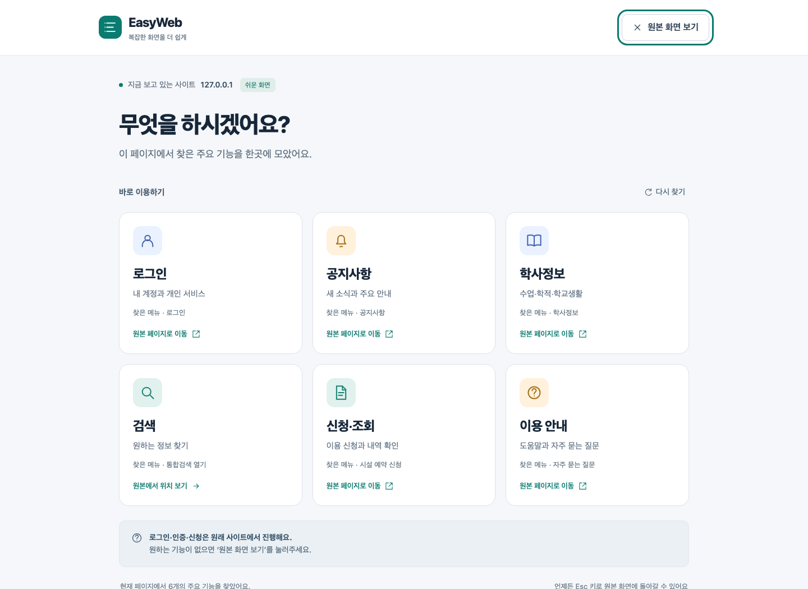

# EasyWeb

복잡한 웹페이지에서 주요 기능을 찾아 큰 버튼으로 안내하는 Chrome 확장 프로그램입니다. 현재는 개발 검증 중인 파일럿 후보입니다.

현재 버전: **0.2.0** · [v1.0 작업명세서](docs/WORK_SPEC.md) · [진행표](docs/PROGRESS.md) · [첫 개발 묶음 결과](docs/RUN_001_REPORT.md) · [시간·토큰 예산](docs/EXECUTION_BUDGET.md)

10단계 완료 기준으로 개발합니다. v0.2에서 입력 보호·동적 후보 무효화·분류·중복 처리를 개선했습니다. 다음 단계는 S05의 원본 액션과 복귀 검증입니다. 기술 검증과 실제 사용자 실증의 상태는 따로 관리합니다.

## 지금 실행하기

빌드된 확장 프로그램은 이 프로젝트의 `dist/` 폴더에 있습니다.

1. Chrome 주소창에서 `chrome://extensions`를 엽니다.
2. 개발자 모드를 켭니다.
3. **압축해제된 확장 프로그램을 로드합니다**를 선택합니다.
4. `/Users/khyun_03/easyweb/dist` 폴더를 선택합니다. 프로젝트 루트가 아니라 `manifest.json`이 있는 `dist`를 선택하세요.
5. 일반 웹사이트에 접속하여 확장 메뉴의 **EasyWeb — 쉬운 화면**을 누릅니다.
6. 원본 화면 보기 / Esc / 확장 버튼을 다시 누르면 닫힙니다.

선택 사항: 확장을 도구 모음에 고정합니다. `Alt+Shift+E` 단축키도 사용할 수 있습니다. 충돌하면 `chrome://extensions/shortcuts`에서 설정하세요.

Chrome 내부 페이지, Chrome 웹 스토어 등 스크립트 주입 제한 페이지에서는 실행되지 않습니다. 도구 모음에 `!`가 표시되면 일반 웹사이트로 이동해 다시 실행하세요. 페이지를 이동한 후에는 확장 버튼을 다시 눌러 분석합니다.

## 로컬 예시 화면

```bash
cd /Users/khyun_03/easyweb
npm run demo
```

브라우저에서 <http://127.0.0.1:4173>을 열고 **EasyWeb 쉬운 화면 열기**를 누릅니다. 테스트용 가상 대학 페이지이며 실제 대학 사이트가 아닙니다. 이 버튼은 화면 코드를 시연하며 Chrome 확장 권한 부여를 재현하지 않습니다.



## 개발 명령

Node.js와 npm을 사용합니다. 현재 환경에서는 Node 26으로 확인했습니다.

```bash
npm ci
npm run build
npm run typecheck
npx playwright install chromium
npm test
```

- `npm run dev`: 변경 시 재빌드. Chrome 확장 관리 화면에서 확장을 새로고침하고 대상 웹페이지도 새로고침합니다.
- `npm run test:live`: 상명대 공개 홈페이지의 탐지·표시를 읽기 전용으로 점검하고 `docs/evidence/`에 결과를 갱신합니다. 외부 사이트 상태에 따라 결과가 달라질 수 있습니다.
- `npm run evaluate -- --engine=current --split=calibration`: 고정된 개발용 10페이지의 추천 정확도·재현율. 데이터와 분리 원칙은 [평가 안내](evaluation/README.md)를 따릅니다.
- `npm run benchmark`: 합성 1천 제어 분석 10회 측정. 실제 전체 사이트 성능이나 화면 준비 시간 검증과 구분합니다.

## 구현한 기능

- 보이는 링크·버튼·검색창의 안전한 이름과 URL, 주요 메뉴·주변 제목을 이용한 기능 분류.
- 로그인 / 검색 / 공지사항 / 학사정보 / 신청·조회 / 이용 안내 중 탐지한 분류만 표시.
- 목적지·원본 제어 기준 중복 제거, 분류 다양성과 중요도에 따라 최대 6개 추천.
- 일반 HTTP(S) 링크 이동. 스크립트 버튼·페이지 내 앵커 등은 원본 요소 위치 강조.
- Shadow DOM의 독립 스타일, 모달 키보드 초점, 모바일 너비 배치, 원본 초점·스크롤 복귀.
- input·textarea·contenteditable·사용자 정의 입력 역할의 입력 내용을 이름 추출에서 제외합니다. 연결된 label·이미지 대체문구·주변 제목의 중첩 입력 경로도 검사합니다. 별도 서버로 분석 결과를 보내지는 않습니다. 원본 링크로 이동하면 해당 사이트의 일반 네트워크 요청은 발생합니다.
- 원본 요소 제거·숨김·이름·href·기준 URL·경로 변경을 감지해 이전 카드를 무효화하고 다시 찾기를 제공합니다. 클릭·가운데 클릭·우클릭·드래그 시점에도 확인합니다.

## 프로젝트 구조

```text
src/                 확장 프로그램 TypeScript와 화면 스타일
extension/           Manifest V3 설정
scripts/             빌드, 로컬 예시 서버, 실제 사이트 확인
demo/                가상 대학 테스트 페이지
tests/               동작·키보드·확장 통합 테스트
evaluation/          5개 공개 사이트 정답표와 축약 메뉴 fixture
dist/                Chrome에서 로드할 빌드 결과
docs/                개발 계획, 검증 결과, 스크린샷
```

## 첫 사용 시 확인할 것

상명대 홈페이지에서 확장 프로그램을 실행하고, 찾은 기능이 실제 목적에 맞는지 확인합니다. ‘원본에서 위치 보기’는 해당 기능을 자동으로 실행하지 않습니다. 강조된 원본 메뉴를 사용자가 눌러 진행합니다. 사이트 자체 팝업이 가리면 먼저 원본 사이트에서 닫아야 할 수 있습니다.

v0.2의 상명대 공개 홈페이지 관찰에서는 **검색·신청/조회·학사정보·로그인·통합검색·공지사항 6개 카드**를 표시했습니다. 탐지·표시 확인이며 실제 업무 완료 결과는 아닙니다. 현재 CSS 표시 상태는 분석하지만 다른 요소가 가리는지까지 판정하지는 않습니다.

개발용 축약 10페이지에서 핵심 기능 재현율은 36.7% → 76.7%입니다. S07 목표인 전체 85%를 아직 충족하지 않았고, 보류용 5페이지·실제 Chrome 도구 모음 실행·수동 접근성·사용자 실증은 미완료입니다. JavaScript 위임 이벤트나 속성으로만 연결된 동작은 URL 복사만으로 원래 동작을 보존할 수 없어 S05의 추가 검증 대상입니다.

## 기술 참고

- [Chrome activeTab](https://developer.chrome.com/docs/extensions/develop/concepts/activeTab)
- [Chrome 스크립트 주입](https://developer.chrome.com/docs/extensions/reference/api/scripting)
- [WCAG 2.2](https://www.w3.org/TR/WCAG22/) — 키보드·초점·확대·대비 검토 기준. 현재 버전의 접근성 인증을 뜻하지 않습니다.
