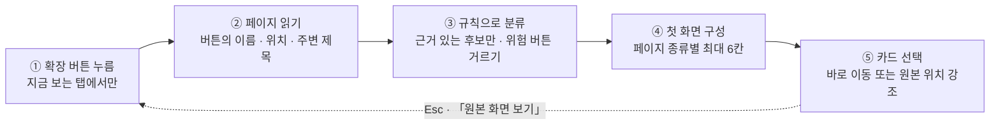
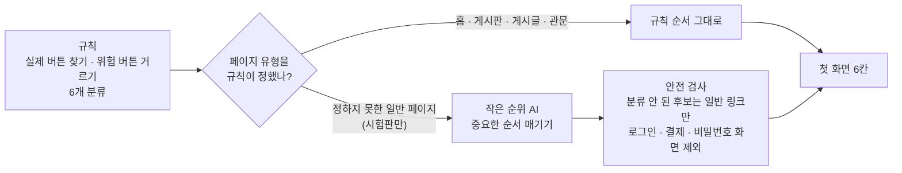
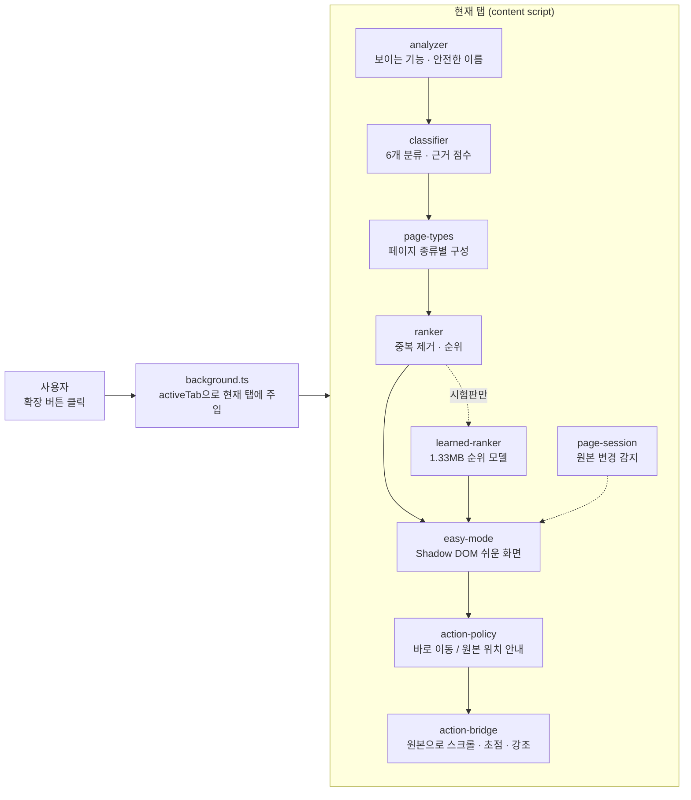

# EasyWeb

**복잡한 기관 홈페이지에서 지금 페이지에 실제로 있는 주요 기능을 찾아, 큰 버튼 6개로 다시 보여 주는 Chrome 확장 프로그램**

2026 천안형 글로벌 인재육성사업 · AX 액션러닝 · 개인 프로젝트 (1인 개발)


<p align="center"><sub>쉬운 화면 (v0.10) — 테스트용 가상 대학 페이지에 적용한 실제 화면. 원래 사이트는 그대로 두고, 그 위에 큰 카드로 다시 보여 줍니다</sub></p>

---

## 한눈에 보기

| | |
| :-- | :-- |
| **누구를 위해** | 학교 · 시청 · 공공기관 홈페이지에서 필요한 메뉴를 찾는 데 오래 걸리는 사람. 대표 사용자는 개발자의 할머니 같은 고령 사용자, 두 번째는 요즘 버튼이 작아 찾기 힘들어진 중년 사용자 |
| **무엇을 줄이나** | 첫 화면에서 "어디를 눌러야 하지?" 하며 메뉴를 여러 번 여는 일 |
| **어떻게** | 보이는 링크 · 버튼 · 검색창을 **규칙으로** 찾아 6개 분류에 넣고, 무엇을 먼저 보여 줄지는 확장 안에 든 **작은 순위 AI**(시험판)가 정함. 없는 기능은 만들지 않음 |
| **안전** | 로그인 · 결제 · 신청을 대신 누르지 않음. 입력한 내용을 읽지 않음. 화면 내용을 서버로 보내지 않음. 권한은 `activeTab` · `scripting` 두 가지 |
| **지금 검증** | 학습에 쓰지 않은 16개 기관 88쪽에서 꼭 필요한 기능 포함률 **37.0% → 42.2%** (규칙만 → 규칙 + 작은 AI, 95% 신뢰구간 +1.5 ~ +8.5%p) · 자동 테스트 541개 통과 · 자동 접근성 21조건 위반 0 |
| **아직 안 한 것** | 실제 어르신 관찰 **0건**, 기관 담당자 인터뷰 0건. 목표(85%)의 절반 수준 |

## 왜 만들었나

기관 홈페이지 첫 화면에는 로그인 · 조회 · 신청 같은 실제 업무 메뉴와 홍보 배너 · 뉴스 · 행사 · SNS가 함께 있습니다.

1. **찾는 것 자체가 어렵다** — 시청 홈페이지에서 여권 신청 안내를 찾아야 하는데, 어디를 눌러야 할지 몰라 메뉴를 여러 번 열어 본다 (개발자의 할머니 사례)
2. **버튼이 작아서 안 보인다** — 예전엔 잘 찾았지만 요즘 버튼이 작아 힘들다 (개발자의 어머니). 화면 전체를 확대하면 메뉴가 화면 밖으로 밀린다
3. **사이트마다 구조가 다르다** — 대학 · 시청 · 정부 · 공공기관 · 도서관이 메뉴 이름과 위치가 모두 달라, 한 곳에서 익힌 방법이 다른 곳에서 통하지 않는다
4. **기존 접근성 도구는 문제를 알려 줄 뿐이다** — "지금 무엇을 누르면 되는지"는 보여 주지 않는다

> 위 두 사례는 개발자가 가족에게 들은 이야기이고, EasyWeb을 보여 주고 관찰한 기록은 아직 없습니다 ([03 사용자 조사](docs/03_user_research.md)).

## 사용 흐름



## 화면

### ① 원본 페이지 → 쉬운 화면

<p align="left">
  
  
  <br>
  <sub>왼쪽: 테스트용 가상 대학 페이지(실제 대학 사이트가 아님) · 오른쪽: 같은 페이지의 쉬운 화면</sub>
</p>

맨 위에는 지금 보고 있는 사이트 주소와 **「자주 쓰는 버튼」 줄**(처음 화면 · 로그인 · 회원가입 중 실제로 있는 것)이 있고, 그 아래 "무엇을 하시겠어요?"와 카드가 나옵니다. 카드마다 분류 이름 · 설명 · 찾은 메뉴 이름 · 이동 방식(「원본 페이지로 이동」 / 「원본에서 계속하기」)을 적습니다.

### ② 「다른 기능 보기」 — 처음 6개 다음

<p align="left">
  
  
  <br>
  <sub>처음엔 최대 6개, 더 필요하면 카드 위 큰 버튼 「다른 기능 보기 →」 · 「← 이전 기능」</sub>
</p>

### ③ 좁은 화면


<sub>390px 너비에서 카드가 한 줄로 재배치됩니다. 320 · 390 · 720 · 1440px와 강제 색상 · 모션 줄이기 상태를 자동으로 검사합니다</sub>

## 주요 기능

| 기능 | 내용 |
| :---- | :---- |
| 주요 기능 찾기 | 보이는 링크 · 버튼 · 검색창을 읽어 **로그인 · 검색 · 공지사항 · 학사정보 · 신청·조회 · 이용 안내** 6개로 분류. 근거(이름 · 위치 · 주변 제목 · 본문 관계)가 있는 것만 채택 |
| 페이지 종류별 첫 화면 | 홈 · 게시판 · 게시글 · 관문 페이지마다 처음 6칸을 다르게 구성 (아래 표) |
| 「자주 쓰는 버튼」 줄 | 처음 화면 · 로그인 · 회원가입은 모든 페이지에 있지만 홈에서만 핵심 기능 → 홈이 아니면 카드에서 빼 위쪽 줄에 둠. 대표 전화도 이 줄에(전화는 걸지 않고 원본 위치 안내) |
| 큰 카드 · 다른 기능 보기 | 처음 최대 6개, 「다른 기능 보기 →」 / 「← 이전 기능」, 「↻ 다시 찾기」 |
| 원본과 안전하게 연결 | 일반 HTTP(S) 링크는 바로 이동. JavaScript 버튼 · 팝업 · 다운로드 · 로그인(SSO) · 같은 페이지 안 이동은 **원본 위치만 강조**하고 사용자가 직접 누름 |
| 낡은 카드 막기 | 원본 페이지가 바뀌거나 버튼이 사라지면 이전 카드를 실행하지 않고 「다시 찾기」 안내 |
| 접근성 | 큰 글씨, 키보드 조작과 초점 관리, 스크린리더 안내, 좁은 화면 재배치, 강제 색상 · 모션 줄이기 대응, Esc로 즉시 원래 화면 |
| 작은 순위 AI (시험판) | 규칙이 유형을 정하지 못한 일반 페이지에서, 규칙이 찾은 안전한 후보의 **순서만** 정함. 확장 안 1.33MB 모델, 한 페이지 약 4ms, 외부 호출 없음. 기본 빌드에는 들어 있지 않음 |

### 페이지 종류별 처음 칸

2026-11-01 사이트 조사(23개 사이트 134쪽)에서 정했습니다 ([10 페이지 유형](docs/10_page_types.md), [`src/page-types.ts`](src/page-types.ts)).

| 페이지 | 처음 칸 |
| :-- | :-- |
| 홈 | 주요 기능 6개, 로그인은 카드로 |
| 게시판 목록 | 검색 + 최신 글 5개 (고정 공지는 뒤로) |
| 게시글 | 첨부 · 목록으로 · 이전 글 · 다음 글 4칸 |
| 관문 페이지 | 사이트 고르기 링크 |

## 무엇을 먼저 보여 줄지는 이렇게 정합니다

**규칙이 먼저, AI는 순서만.** AI가 페이지에 없는 버튼을 지어내면 안 되는 서비스라, 후보는 언제나 규칙이 찾은 실제 버튼입니다.



- 규칙은 [`src/classifier.ts`](src/classifier.ts)(분류) · [`src/ranker.ts`](src/ranker.ts)(중복 제거 · 순위) · [`src/action-policy.ts`](src/action-policy.ts)(직접 이동 / 원본 위치 안내)에 있습니다.
- 작은 AI는 [`src/learned-ranker.ts`](src/learned-ranker.ts)와 [`src/model/learned-ranker.json`](src/model/learned-ranker.json)입니다. 시험판 빌드(`node scripts/build.mjs --learned` → `dist-learned/`)에만 들어갑니다.

### 작은 AI는 어떻게 골랐나

엔진 결과를 보지 않은 검토자(Claude)가 23개 사이트 134쪽에 "꼭 필요한 기능" 정답표를 만들었고, 이것으로 여러 방식을 비교했습니다. 아래 숫자는 **꼭 필요한 기능 포함률**(검토자가 꼽은 필수 기능 중 첫 화면 카드 6칸 · 자주 쓰는 버튼에 나온 비율)입니다 ([09 로컬 AI 검토](docs/09_local_ai_review.md) 12절).

| 방식 | 개발 134쪽 | 처음 보는 89쪽 | 한 페이지 시간 | 비고 |
| :-- | --: | --: | :-- | :-- |
| 규칙만 (지금 기본 빌드) | 37.2% | 41.4% | — | |
| 작은 모델 (로지스틱, 1MB) | 43.6% | 48.2% | 2ms | |
| **순위 학습 (LightGBM LambdaRank)** | **47.3%** | **53.2%** | 약 4ms | **선택** — 작은 모델 중 가장 좋음 |
| 리랭커 조정 학습 (1.2억 파라미터) | 42.0% | 48.2% | 약 100ms | 크기에 비해 이점 없음 |
| 로컬 LLM gemma4:12b (참고) | 53.4% | 57.9% | 13~20초 | 어르신이 기다리기엔 너무 김 |

순위 학습을 확장에 넣을 수 있게 줄였습니다(모델 1.33MB, gzip 313KB, Python과 점수 차이 0). 그 뒤 **새로 모은 16개 기관 88쪽**으로 한 번만 다시 채점했습니다(엔진 · 모델을 먼저 고정 → 수집 → 검토 → 채점).

| 빌드 | 88쪽 | 기본 대비 (95% 구간) |
| :-- | --: | :-- |
| 기본 (규칙만) | 37.0% | — |
| **시험판 (규칙 + 작은 AI)** | **42.2%** | **+1.5 ~ +8.5%p** |

오시는 길 · 조직 28.7% → 48.3%, 서비스 안내 28.2% → 41.0%로 크게 올랐고, 게시판(68.3%)은 같고, 홈(23.6% → 22.6%)은 오르지 않았습니다 ([09](docs/09_local_ai_review.md) 14절). 기준이 Claude 검토자라는 점, 사람 관찰이 0건이라는 점이 한계입니다.

## 구성



외부 서버가 없습니다. 분석 결과는 화면을 닫으면 메모리에서 지워지고, 쿠키 · 확장 저장소도 쓰지 않습니다.

| 영역 | 기술 |
| :---- | :---- |
| 확장 | TypeScript, Chrome Extension Manifest V3, Shadow DOM |
| 빌드 | Node.js, esbuild |
| 검사 | Playwright, axe-core, headless Chromium |
| 작은 AI (개발 도구) | Python, LightGBM (학습은 프로젝트 밖 가상 환경, 제품 의존성 아님) |
| 개발 방식 | Claude Code로 바이브코딩 — 문서(PRD · 할 일 · 개발 계획)를 먼저 고치고 코드를 고침 |

## 시작하기

### 1. 바로 설치 (빌드된 확장)

1. 이 저장소를 받습니다: `git clone https://github.com/khyun-0123/easyweb.git`
2. Chrome에서 `chrome://extensions`를 엽니다.
3. 오른쪽 위 **개발자 모드**를 켭니다.
4. **압축해제된 확장 프로그램을 로드합니다** → 저장소의 `dist/` 폴더를 고릅니다.
5. 일반 웹사이트(예: 시청 · 대학 홈페이지)에서 툴바의 **EasyWeb — 쉬운 화면**을 누릅니다.

- `chrome://` 같은 브라우저 내부 페이지에서는 실행되지 않습니다.
- 다른 사이트로 이동하면 권한이 풀리므로 새 페이지에서 버튼을 다시 누릅니다.
- 자세한 설치 · 업데이트 · 제거 절차: [설치 안내](docs/INSTALL.md)

### 2. 직접 빌드

Node.js와 npm이 필요합니다.

```bash
git clone https://github.com/khyun-0123/easyweb.git
cd easyweb
npm ci
npm run build                          # dist/ (기본: 규칙만)
node scripts/build.mjs --learned       # dist-learned/ (시험판: 규칙 + 작은 AI)
```

### 3. 데모 페이지

```bash
npm run build
npm run demo     # http://localhost:4173 에 가상 대학 데모 페이지 (「EasyWeb 쉬운 화면 열기」 버튼)
```

환경 변수나 API 키는 없습니다.

## 명령어

| 명령 | 설명 |
| :---- | :---- |
| `npm run build` | 기본 확장 빌드 → `dist/` |
| `node scripts/build.mjs --learned` | 시험판 빌드 (작은 순위 AI 포함) → `dist-learned/` |
| `npm run dev` | 파일이 바뀌면 다시 빌드 |
| `npm run typecheck` | 타입 검사 |
| `npm test` | 빌드 + Playwright 전체 테스트 |
| `npm run test:a11y` | 자동 접근성 21조건 검사 (axe-core, 화면 너비 · 강제 색상 · 모션 줄이기) |
| `npm run verify` | 타입 · 빌드 · 전체 테스트 · 품질 · 합성 성능을 한 번에 |
| `npm run benchmark` | 1,000개 제어 합성 페이지 성능 (분석 ≤ 300ms · 화면 준비 ≤ 1초) |
| `npm run demo` | 로컬 데모 페이지 (`http://localhost:4173`, `--port=`로 변경) |
| `node scripts/site-survey.mjs --replay` | 저장한 사이트 화면으로 사이트 조사 다시 재기 (`--learned`로 시험판) |

## 폴더 구조

```
├─ src/                       확장 소스 (TypeScript)
│  ├─ background.ts           확장 버튼 → 현재 탭에 주입
│  ├─ content.ts              현재 탭 진입점
│  ├─ analyzer.ts             보이는 링크 · 버튼 · 검색창과 안전한 이름 수집
│  ├─ classifier.ts           6개 분류와 근거 점수
│  ├─ page-types.ts           홈 · 게시판 · 게시글 · 관문 페이지별 처음 칸
│  ├─ ranker.ts               중복 제거와 첫 화면 순위
│  ├─ easy-mode.ts · styles.css  쉬운 화면 (Shadow DOM)
│  ├─ action-policy.ts        바로 이동 / 원본 위치 안내 구분
│  ├─ action-bridge.ts        원본으로 스크롤 · 초점 · 강조 (클릭 · 제출은 하지 않음)
│  ├─ page-session.ts         원본 변경 감지 · 낡은 카드 막기
│  ├─ *-relations.ts · *-evidence.ts  서비스 · 문서 관계, 본문 근거
│  ├─ learned-ranker.ts · learned-hook*.ts  작은 순위 AI (시험판)
│  └─ model/learned-ranker.json            순위 모델 (1.33MB)
├─ extension/manifest.json    권한: activeTab · scripting
├─ dist/                      빌드된 확장 (바로 설치용)
├─ scripts/                   빌드 · 검사 · 평가 · 사이트 조사
│  └─ ml/                     작은 AI 학습 · 내보내기 · JS 이식 확인
├─ tests/                     Playwright 테스트
├─ evaluation/                정답표 · 검토 기준 · 조사 사이트 목록
└─ docs/                      기획 · 설계 · 검증 문서, 포스터
```

## 설계 원칙

- **있는 것만 보여 준다.** 페이지에 실제로 있고 근거가 있는 기능만 카드로 만든다. 평가용 ID · 정답 순서 같은 지름길을 쓰지 않는다
- **사람이 직접 누를 자리를 남긴다.** 로그인 · 인증 · 결제 · 신청 · 삭제 · 폼 제출을 대신하지 않고, 원본 위치만 강조한다
- **읽지 않을 것은 읽지 않는다.** 입력창 · 편집 영역의 값을 후보 · 화면 · 기록 어디에도 넣지 않는다
- **규칙이 먼저, AI는 순서만.** AI는 규칙이 찾은 안전한 후보 안에서만 순서를 정하고, 확장 안에서 돌며 외부로 보내지 않는다
- **첫 결과를 고치지 않는다.** 처음 보는 자료의 첫 채점은 결과가 나빠도 그대로 남기고, 고친 뒤 결과는 따로 적는다 (예: v0.9 첫 독립 평가 재현율 2/15 실패 기록 보존)
- **인증을 대신한다고 말하지 않는다.** EasyWeb은 웹 접근성 인증을 대신하지 않는 보조 탐색 도구이고, 언제든 끌 수 있다

## 진행 상황

| 날짜 | 한 일 |
| :-- | :-- |
| 10/17 | v0.2 — 분석 · 분류 엔진과 평가 도구 첫 버전 |
| 10/18 ~ 10/31 | v0.3 ~ v0.10 — 기관 5곳(상명대 · 천안시 · 국민안전24 · 국민연금공단 · 국립중앙도서관) 60쪽으로 개발, 자동 접근성 · 성능 검사, 처음 보는 자료 첫 평가(재현율 2/15 실패) 기록 |
| 10/31 | 문서 체계(00~10) 정리, PRD v2 — 대표 사용자 확정, 화면 이름 「다른 기능 보기」 · 「이전 기능」 |
| 11/01 | 23개 사이트 134쪽 조사 → 페이지 종류별 처음 칸 · 「자주 쓰는 버튼」 줄 |
| 11/12 | KRDS(정부 디자인 시스템) 검토, 조사에서 찾은 카드 선택 문제 수정 |
| 11/15 | 사용자 컴퓨터에서 돌리는 AI 점검 (로컬 LLM · Chrome 내장 AI) |
| 11/17 | 처음 보는 16곳 89쪽 독립 확인 — 작은 학습 모델 41.4% → 48.2% |
| 11/18 | 순위 학습 · 리랭커 비교 → 순위 학습 선택, 사업성 검토 |
| 11/19 | 시험판 빌드(작은 AI) · 새 16곳 88쪽 재확인 37.0% → 42.2% · 게시글 규칙 3개 수정(이전글/다음글 읽기, 크기가 붙은 첨부를 다운로드로) |
| 11/23 | A2 포스터 ([docs/poster](docs/poster/)) · README 정리 |
| 11/27 | (예정) 개인 프로젝트 코드 최종 제출 |
| 11/28 | (예정) IR Day |

**다음 할 일:** 할머니 · 어머니 짧은 관찰(원본 vs EasyWeb, 과제 2~3개) → 디지털배움터 · 복지관 공용 PC에서 6~8명 비교 실증 · 실제 Chrome 설치와 VoiceOver · 200/400% 확대 확인 · 기관 담당자 인터뷰 · 시험판을 기본으로 켤지 결정 ([07 할 일](docs/07_todo.md))

## 문서

| 문서 | 내용 |
| :---- | :---- |
| [00 문서 안내](docs/00_index.md) | 문서 체계와 읽는 순서 |
| [01 PRD](docs/01_prd.md) | 사용자 · 문제 · 기능 3가지 · 성공 기준 |
| [02 벤치마킹](docs/02_benchmarking.md) | 비슷한 서비스 조사 |
| [03 사용자 조사](docs/03_user_research.md) | 관찰 · 인터뷰 기록 (현재 0건)과 계획 |
| [04 구조도](docs/04_architecture.md) · [05 handoff](docs/05_handoff.md) | 모듈 구조, 권한 · 저장 · 실패 조건 |
| [06 화면](docs/06_screens.md) | 쉬운 화면 구성과 상태별 화면 |
| [07 할 일](docs/07_todo.md) · [08 개발 계획](docs/08_dev_plan.md) | 결정 대기 · 단계별 할 일, 범위와 원칙 |
| [09 로컬 AI 검토](docs/09_local_ai_review.md) | 로컬 AI · 작은 모델 시험, 독립 확인, 시험판 빌드, 게시글 규칙 (1~15절) |
| [10 페이지 유형](docs/10_page_types.md) | 홈 · 게시판 · 게시글 등 처음 칸 설계 |
| [사이트 조사 (11/01)](docs/reviews/site_survey_20261101.md) | 23개 사이트 134쪽, 놓친 기능의 원인 |
| [독립 확인 (11/17)](docs/reviews/independent_ai_20261117.md) | 처음 보는 89쪽, 증류 시험 |
| [사업성 검토 (11/18)](docs/reviews/business_review_20261118.md) | 공공 쪽 쓰임새, 유료 API 사용안 (탁상 검토) |
| [포스터](docs/poster/) | A2 포스터 HTML · PDF |
| [설치 안내](docs/INSTALL.md) · [검증 범위와 한계](docs/VALIDATION.md) | 설치 · 업데이트 · 제거, 자동 검사가 뜻하는 것과 아닌 것 |
| [사용자 실증 계획](docs/USER_STUDY.md) · [1인 사전 시험](docs/PRETEST.md) | 6~8명 비교 실증 절차 |
| [진행표](docs/PROGRESS.md) | 단계별 공식 판정 기록 |

<sub>README의 화면 사진은 v0.10 개발 화면이며, 테스트용 가상 대학 페이지(실제 대학 사이트가 아님)에서 찍었습니다. 수치는 2026-11-19 기준이고, 정답 기준은 Claude 검토자, 사람 관찰은 0건입니다.</sub>
