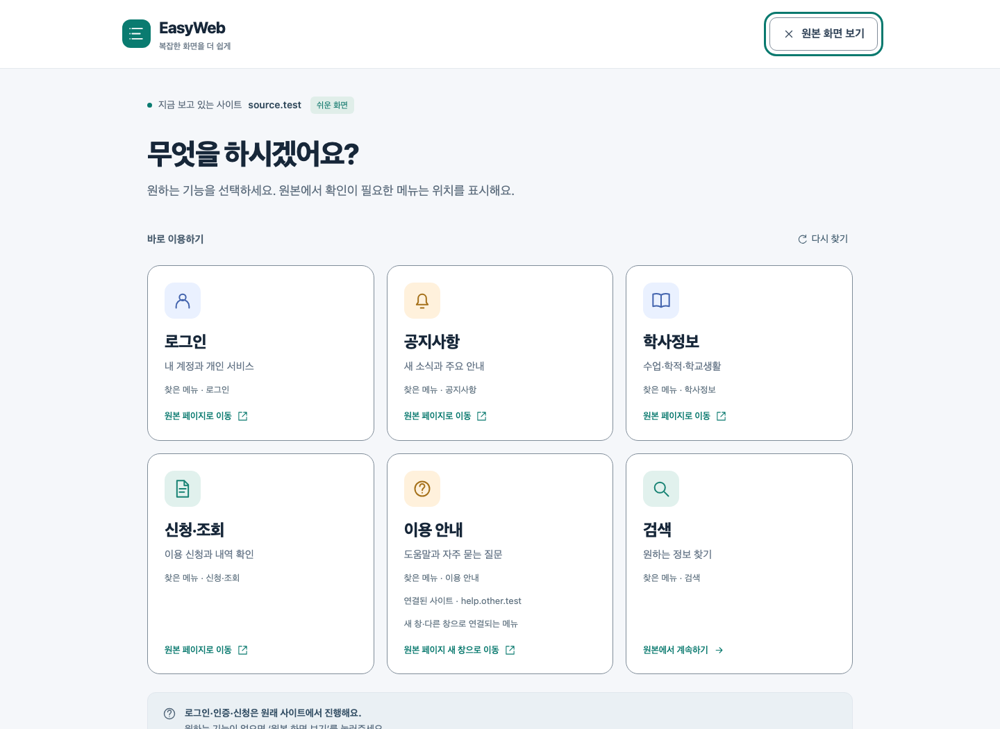

# **06 화면**

EasyWeb · 1인 프로젝트
버전: v1 (2026-10-31, v0.10.0 화면 기준) · 접근성 검사 범위: [ACCESSIBILITY](ACCESSIBILITY.md)

**이 문서는 최종 문서입니다.** 화면이 바뀌면 덮어씁니다. 이미지는 자동 접근성 검사(`npm run test:a11y`)가 합성 페이지에서 찍은 스크린샷이며, 실제 기관 사이트 화면이 아닙니다.

---

## 1. 이미지 목록

| 번호 | 상태 | 이미지 | 한 줄 설명 |
| :---- | :---- | :---- | :---- |
| 01 | 기본 | [desktop-normal](evidence/run010/a11y-screenshots/desktop-normal.png) | 「자주 쓰는 버튼」 줄(로그인) + 카드 5개, 이동/원본 안내 혼합 (v0.11. v0.10은 [카드 6개](evidence/run009/a11y-screenshots/desktop-normal.png)) |
| 02 | 다른 기능 있음 | [desktop-overflow](evidence/run010/a11y-screenshots/desktop-overflow.png) | 카드 위 「다시 찾기」·「다른 기능 보기 →」, "1번째 화면" (v0.11) |
| 03 | 다른 기능으로 넘김 | [desktop-overflow-next](evidence/run010/a11y-screenshots/desktop-overflow-next.png) | 2번째 화면, 「← 이전 기능」 (v0.11) |
| 04 | 기능 없음 | [desktop-empty](evidence/run009/a11y-screenshots/desktop-empty.png) | "주요 기능을 찾지 못했어요" |
| 05 | 원본 바뀜 | [desktop-stale](evidence/run009/a11y-screenshots/desktop-stale.png) | 낡은 카드 차단, 다시 찾기 안내 |
| 06 | 원본 안내 성공 | [desktop-success](evidence/run009/a11y-screenshots/desktop-success.png) | 원본 제어 강조 |
| 07 | 원본 안내 실패 | [desktop-failure](evidence/run009/a11y-screenshots/desktop-failure.png) | 가려짐·변경 안내, 「안내 닫기」 |
| 08 | 긴 이름 | [desktop-long](evidence/run009/a11y-screenshots/desktop-long.png) | 긴 메뉴 이름 줄바꿈 |
| 09 | 모바일 너비 390px | [mobile-390-normal](evidence/run009/a11y-screenshots/mobile-390-normal.png) | 한 줄 카드 재배치 |
| 10 | 강제 색상 | [forced-colors-normal](evidence/run009/a11y-screenshots/forced-colors-normal.png) | 고대비 모드 |
| 11 | 실제 사이트 비교 (과거) | [원본](evidence/smu-original.png) · [쉬운 화면](evidence/smu-easy-mode.png) | 상명대 홈페이지, 초기 버전 화면 |

## 2. 기본 화면 구성

| 위치 | 내용 | 동작 |
| :---- | :---- | :---- |
| 맨 위 왼쪽 | EasyWeb 로고, "복잡한 화면을 더 쉽게" | — |
| 맨 위 오른쪽 | 「원본 화면 보기」 (처음 초점) | 쉬운 화면 닫기, 원래 초점·스크롤 복귀 |
| 머리 | ● 지금 보고 있는 사이트 `주소` · `쉬운 화면` 표시 | — |
| 자주 쓰는 버튼 | "자주 쓰는 버튼" 「처음 화면」·「로그인」·「회원가입」·「전화 1588-0000」(대표 전화, 2026-11-01) 중 페이지에 있는 것. 전화는 걸지 않고 원본의 번호 위치를 보여 줌 (없으면 줄 전체 숨김). 홈 페이지에서는 로그인이 카드로 가므로 이 줄에 없음 | 카드와 같음: 일반 링크는 바로 이동, 스크립트 로그인은 원본 위치 표시, 원본이 바뀌면 막음 |
| 제목 | "무엇을 하시겠어요?" / "원하는 기능을 선택하세요. 원본에서 확인이 필요한 메뉴는 위치를 표시해요." | — |
| 카드 영역 머리 | 왼쪽 「바로 이용하기」·"N번째 화면"(더 있을 때만), 오른쪽 큰 버튼 「↻ 다시 찾기」·「다른 기능 보기 →」 | 다시 찾기: 다시 분석·초점 유지·찾은 개수 안내 / 다른 기능 보기: 다음 화면, 첫 카드로 초점 |
| 카드 (최대 6개, 게시글 페이지 4개) | 분류 아이콘 · 분류 이름(게시판·게시글·관문 페이지에서는 글 제목·"목록으로"·"이전 글"·사이트 이름) · 설명 · "찾은 메뉴 · 원본 이름" · (다른 사이트면) "연결된 사이트 · 호스트" · (새 창이면) "새 창·다른 창으로 연결되는 메뉴" | 아래 3절 |
| 카드 아래 | 「← 이전 기능」 / 「다른 기능 보기 →」 (있을 때만) | 화면 전환, 첫 카드로 초점. 화살표는 화면에만 보이고 스크린리더는 읽지 않음 |
| 맨 아래 안내 | "로그인·인증·신청은 원래 사이트에서 진행해요." "원하는 기능이 없으면 '원본 화면 보기'를 눌러주세요." | — |
| 어디서나 | Esc | 원본 화면으로 복귀 |

분류 6개와 카드 설명 (`types.ts`):

| 분류 | 설명 | 아이콘 |
| :---- | :---- | :---- |
| 로그인 | 내 계정과 개인 서비스 | 사람 |
| 검색 | 원하는 정보 찾기 | 돋보기 |
| 공지사항 | 새 소식과 주요 안내 | 종 |
| 학사정보 | 수업·학적·학교생활 | 책 |
| 신청·조회 | 이용 신청과 내역 확인 | 문서 |
| 이용 안내 | 도움말과 자주 묻는 질문 | 물음표 |

## 3. 카드를 눌렀을 때

| 카드 하단 문구 | 언제 | 무슨 일이 일어나나 |
| :---- | :---- | :---- |
| 「원본 페이지로 이동」 ↗ | 일반 HTTP(S) 링크 | 원본이 그대로인지 확인한 뒤 그 주소로 이동 |
| 「원본 페이지 새 창으로 이동」 ↗ | 원본 링크가 새 창 링크 | 같은 확인 후 새 창 |
| 「원본에서 계속하기」 → | 스크립트 버튼·팝업·다운로드·로그인·같은 페이지 앵커·검색창 | 쉬운 화면을 닫고 원본 제어로 스크롤·초점·강조. 사용자가 직접 누름 |

원본이 바뀌었으면 위 동작 대신 "원본 페이지가 바뀌었어요. 다시 찾기를 눌러주세요."를 보여 줍니다.

## 4. 접근성 요구 (화면 쪽)

- 모든 동작은 키보드로 가능 (Tab/Shift+Tab 순환, Esc 복귀), 초점 표시가 보여야 함
- 일반 링크 카드는 링크, 원본 안내 카드는 버튼으로 읽힘
- 상태 변화(다시 찾기, 메뉴 전환, 실패)는 스크린리더 상태 안내
- 글자 대비 4.5:1 이상, 누르는 영역 48px 이상, 320 CSS px에서 가로 스크롤 없음
- 강제 색상·모션 감소 모드 대응

현재: 자동 21조건 위반 0. **실제 VoiceOver 발화와 실제 브라우저 200/400% 확대는 미확인** → [07](07_todo.md) 2단계

## 5. 화면 개선 아이디어 (결정 전)

사용자 관찰(03)이 생기기 전에는 바꾸지 않고 여기 모아 둡니다.

- "원본"이라는 말이 대상 사용자에게 어려울 수 있음 → "원래 화면" 등 대안 (03 U2에서 확인)
- 카드가 어떤 근거로 골라졌는지 한 줄로 보여 줄지 (신뢰 vs 복잡함)
- ~~몇 번째 화면인지 표시~~ → "N번째 화면"으로 반영 (v0.11)
- **(2026-10-31 사용자 피드백, 반영함)** 「다른 메뉴 보기」가 카드 아래 왼쪽에 있어 스크롤해야 보이고, 「다시 찾기」도 작아서 "다른 기능 보기·새로고침이 있었으면"이라는 반응이 나옴 → 07 D12
